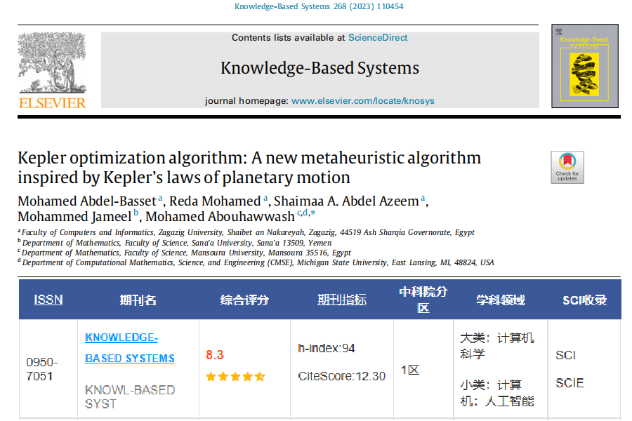
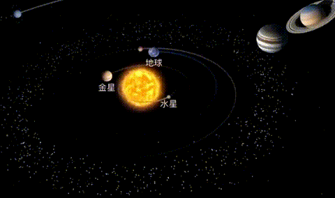
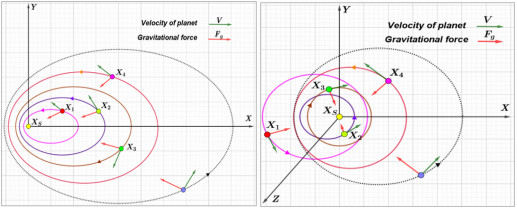
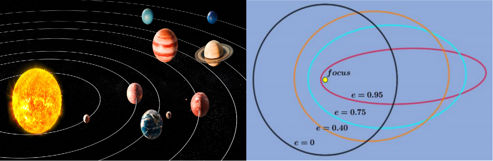
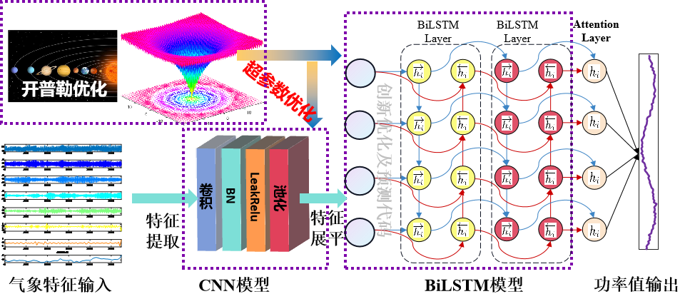
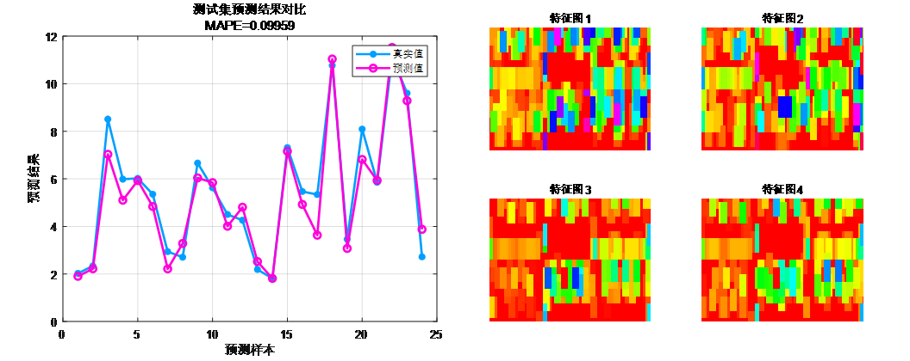
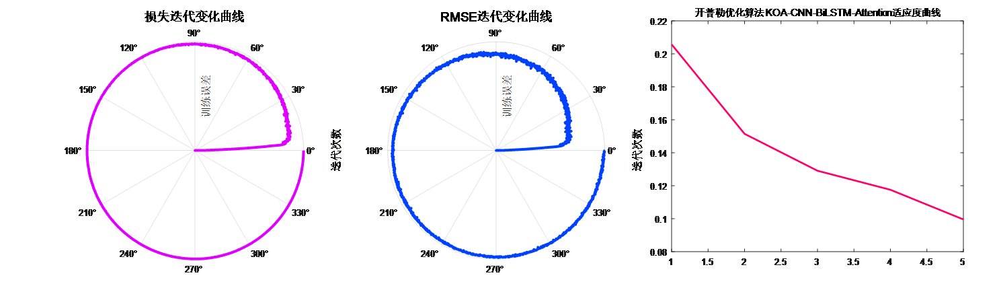

# Optimization for Zone I directly written! KOA-CNN-BiLSTM-Attention Kepler optimized convolution, long short-term memory network fusion attention multivariate regression prediction

Applicable Platform: MATLAB 2023 version and above
KOA Kepler Optimization Algorithm, published in the top-tier journal "Knowledge-Based Systems" in May 2023.
The algorithm was introduced recently and has not yet been applied in literature.
Similarly, we utilized this newly developed algorithm to optimize the hyperparameters in our CNN-BiLSTM-Attention time-series and spatial feature combination - attention mechanism regression prediction program code, forming the KOA-CNN-BiLSTM-Attention multivariate regression prediction model.
This paper introduces a novel metaheuristic algorithm called the Kepler Optimization Algorithm (KOA), which is evaluated. The KOA is inspired by the laws of Kepler's planetary motion and aims to solve continuous optimization problems. In the KOA, each planet and its position represent a candidate solution, and the optimization process is achieved through random updates based on the best solution (sun) so far, thereby more effectively exploring and utilizing the search space. Performance of the KOA algorithm is evaluated using various benchmark problems and compared with other stochastic optimization algorithms. The results show that the KOA outperforms other optimizers in terms of convergence and statistical data.
The KOA's Kepler optimization steps mainly include initializing planet positions and speeds, evaluating the fitness of each planet according to the fitness function, updating the positions and speeds of each planet, updating the position of the best solution (sun), repeating the update steps until the stop condition is met, etc. These steps enable the KOA to better explore and utilize the search space during the optimization process.
The innovative aspects of the constructed KOA-CNN-BiLSTM-Attention multivariate regression prediction model are as follows:
KOA algorithm's innovativeness compared to traditional intelligent algorithms:
1. Inspired by Kepler's laws of planetary motion: The KOA algorithm is inspired by Kepler's laws of planetary motion, treating each planet's position as a candidate solution and updating these candidates through random updates for optimization. This design enables the KOA algorithm to more effectively explore and utilize the search space.
2. Physics-based metaheuristic algorithm: The KOA algorithm belongs to the physics-based metaheuristic algorithm category, simulating the movement patterns of planets around the sun for optimization. It uses parameters such as planet's position, mass, gravitational force, and orbital speed to control the update process of candidate solutions. This physics-based approach enhances the interpretability of the KOA algorithm in global optimization problems.
3. Superiority over other optimization algorithms: Through comparative experiments with other stochastic optimization algorithms, the KOA algorithm demonstrates superior convergence and statistical performance. Experimental results show that the KOA algorithm outperforms other comparative algorithms on multiple benchmark problems. This indicates that the KOA algorithm has higher efficacy and performance in solving optimization problems.
Optimization application—Advanced multivariate time series regression prediction algorithm based on Kepler Optimization Algorithm (KOA), Convolutional Neural Network (CNN), Bidirectional Long Short-Term Memory Network (BiLSTM), and Multi-Head Self-Attention mechanism (MlutiHead SelfAttention):
\n        \n      Functions:
1. Multivariate feature input, single sequence variable output, inputting features from the previous day to predict the next day, achieving 24-step ahead predictions.
2. Optimize learning rates, convolution kernel sizes, and number of neurons using the KOA optimization algorithm, aiming to minimize MAPE as the objective function.
3. Provide loss and RMSE iterative change polar coordinates graph; network feature visualization graph; test comparison graph; fitness curve (if the initial precision is highest, then the fitness curve will be a horizontal line).
4. Provide MAPE, RMSE, MAE, etc. for calculation results display.
Applicable fields: Wind speed prediction, photovoltaic power prediction, power generation prediction, carbon price prediction, and other applications.
Dataset format:
\n        \n      18 meteorological features the day before, sampling time is 24 hours, output is the power output of the next day's 24 hours, which is 18×24 input, 1×24 output, there are a total of 75 such samples.
Comparison between predicted values and actual values; Visualization of training features:
\n        \n      A polar coordinate form of the training error curve (error gradually approaching zero from inside to outside); Fitness curve (error gradually decreasing)

## Images

<!-- PAYMENT_BLOCK -->

## Get this dataset

- Payment link (Stripe): [Buy now](https://buy.stripe.com/3cs8yP7sY87d0vu9AB)
- Payment QR code: 

<!-- /PAYMENT_BLOCK -->
